[](https://github.com/LahaLuhem/list_smith/actions/workflows/ci.yml)
[](https://coveralls.io/github/LahaLuhem/list_smith?branch=main)
[](https://github.com/LahaLuhem/list_smith/pulls)
[](https://pub.dev/packages/list_smith)
[](https://pub.dev/packages/list_smith/score)
[](./LICENSE)
[](https://github.com/LahaLuhem/list_smith/issues)
[](https://github.com/LahaLuhem/list_smith/issues?q=is%3Aissue+is%3Aclosed)
[](https://github.com/LahaLuhem/list_smith/pulls)
[](https://github.com/LahaLuhem/list_smith/pulls?q=is%3Apr+is%3Aclosed)

<!-- TOC start (generated with https://github.com/derlin/bitdowntoc) -->

- [Install](#install)
- [Why list_smith?](#why-list_smith)
- [A quick taste](#a-quick-taste)
- [2 kinds of list](#2-kinds-of-list)
- [Pagination](#pagination)
    * [Where the data ends](#where-the-data-ends)
- [Pull to refresh](#pull-to-refresh)
    * [Refreshing from code](#refreshing-from-code)
- [Editing loaded items](#editing-loaded-items)
    * [When your server sorts the list](#when-your-server-sorts-the-list)
    * [Before your server answers](#before-your-server-answers)
    * [Animating edits](#animating-edits)
    * [On a `.sync` list](#on-a-sync-list)
- [Search](#search)
    * [In memory, with `ListSmith.sync`](#in-memory-with-listsmithsync)
    * [Paged, with `ListSmith.async`](#paged-with-listsmithasync)
    * [You keep the search field](#you-keep-the-search-field)
    * [Searching from code](#searching-from-code)
- [Grouping](#grouping)
- [Make it look like your app](#make-it-look-like-your-app)
    * [Show your own rows while it loads](#show-your-own-rows-while-it-loads)
- [Watching what it does](#watching-what-it-does)
- [Scroll and layout](#scroll-and-layout)
- [Races and late answers](#races-and-late-answers)
- [Performance](#performance)
- [The example app](#the-example-app)
- [Contributing](#contributing)

<!-- TOC end -->

**list_smith** builds the lists you actually ship, lazily like `ListView.builder`: pagination,
pull-to-refresh and search, in memory or paged. Hand it a source, an item builder and a bit of
config. It owns the scrollable and every loading, error and empty state, so there's nothing to wire
up.

<p align="center">
  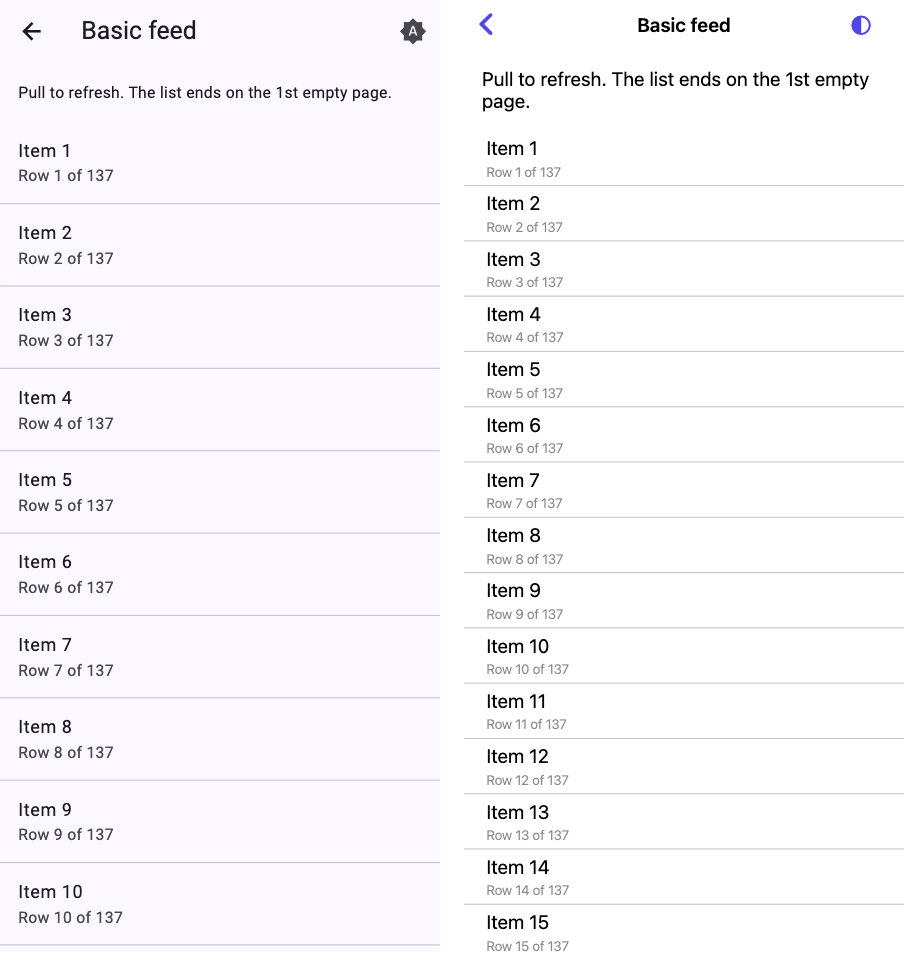<br>
  <sub><b>Material</b> on the left, <b>Cupertino</b> on the right</sub>
</p>

<table>
  <tr>
    <td align="center">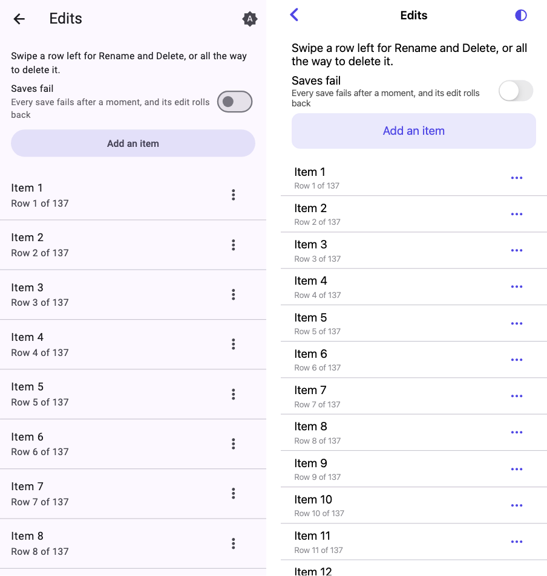<br><sub><b>Edits</b> · add, swipe away, rename</sub></td>
    <td align="center">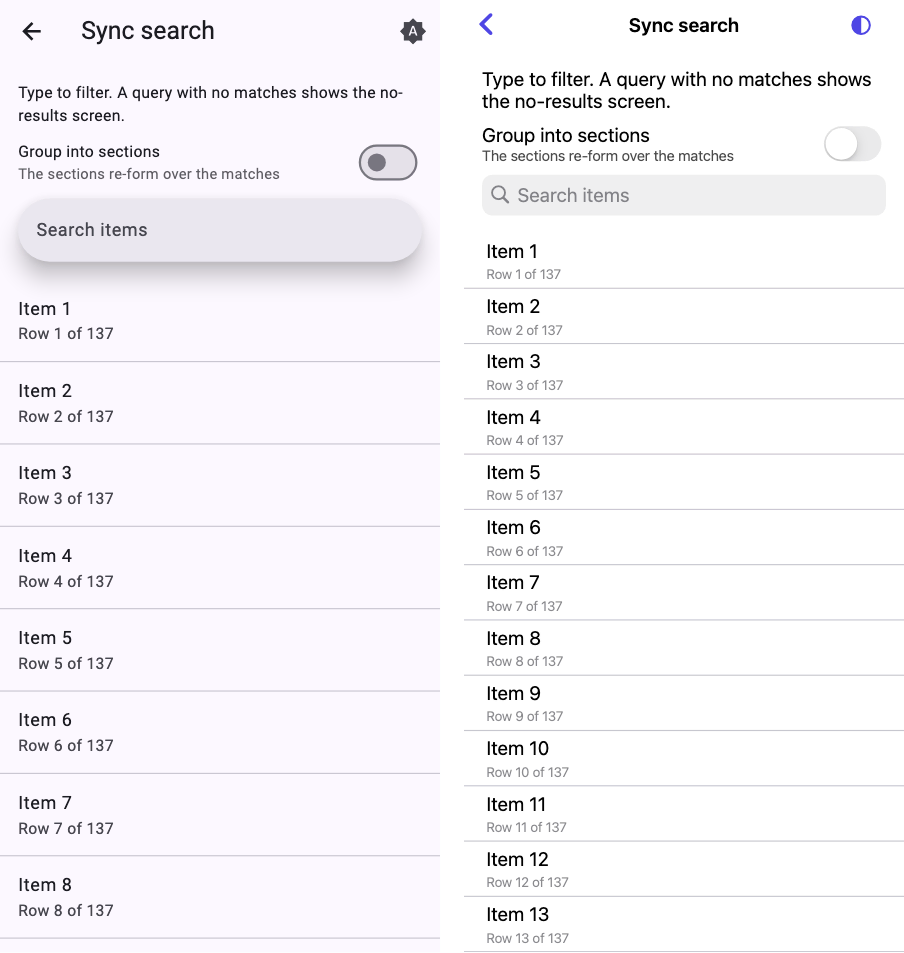<br><sub><b>Search</b> · in memory, then grouped</sub></td>
  </tr>
</table>

## Install

```sh
flutter pub add list_smith
```

## Why list_smith?

Plenty of packages page a list, most with Material widgets for you to override. list_smith ships
none.

|                                   |                                                                                                                                             |
|-----------------------------------|---------------------------------------------------------------------------------------------------------------------------------------------|
| **No design system**              | Nothing in `lib/` imports `material.dart` or `cupertino.dart`, so every default looks at home in Material, Cupertino or your own thing.     |
| **1 widget, not 3**               | Paging, search and grouping in one list. A group split across pages still gets one header.                                                  |
| **Your fetcher knows why it ran** | Each request carries a `trigger` (first load, next page, pull, retry, query change, `invalidate()`), so you pick cache or network per call. |
| **Swap behaviour, not widgets**   | Sealed seams for refresh, search, end detection, empty pages, grouping and edit transitions. Use a built-in or write your own.              |
| **Perf is measured, not claimed** | A committed [benchmark suite](#performance), so a regression shows up as a number.                                                          |

## A quick taste

A fetcher, an item builder, and an `itemIdGetter` so the list can tell items apart:

```dart
ListSmith.async(
  fetchPage: PageFetcher((request) => api.fetchArticles(page: request.pageIndex, size: request.pageSize)),
  itemIdGetter: (article) => article.id,
  itemBuilder: (context, article, index) => ArticleTile(article),
)
```

That already pages as you scroll, pulls to refresh, shows loading and errors with a retry, and knows
when it's hit the end. No id field? A value with its own `==` (an `int`, a `String`, a record) can
be its own: `itemIdGetter: (item) => item`.

## 2 kinds of list

Pick by where your data lives:

| Constructor       | Best for                                | Handles                                                |
|-------------------|-----------------------------------------|--------------------------------------------------------|
| `ListSmith.async` | data fetched a page at a time (an API)  | pagination, pull-to-refresh, and optional async search |
| `ListSmith.sync`  | a list you already hold in memory       | client-side search, nothing to paginate                |

Each takes only the parameters that make sense for it, so nothing you pass is quietly ignored.

## Pagination

`fetchPage` gets a `PageRequest` and returns that page's items, any `Iterable`. The next page is
asked for as the user nears the end, and an empty page ends the list:

```dart
ListSmith.async(
  pageSize: 30,
  fetchPage: PageFetcher((request) => repo.load(request.pageIndex, request.pageSize)),
  itemIdGetter: (item) => item.id,
  itemBuilder: (context, item, index) => Text(item.title),
)
```

<details>
<summary><b>Knowing why a page was fetched</b></summary>

Serving a pull-to-refresh from cache defeats the pull, so `request.trigger` says why each page was
asked for:

| `FetchTrigger` | What happened                                                                  |
|----------------|--------------------------------------------------------------------------------|
| `initialLoad`  | the 1st page of a cold list                                                    |
| `nextPage`     | the user neared the end, so the next page was asked for                        |
| `refresh`      | a pull-to-refresh, or `ListSmithController.refresh()`                          |
| `retry`        | this page's last attempt threw, and Retry was tapped                           |
| `queryChanged` | a committed query, typed or by `search()`, entering or leaving search included |
| `invalidated`  | your data changed: you called `invalidate()` or `reset()`, or removed rows     |

```dart
fetchPage: PageFetcher((request) => repo.load(
  request.pageIndex,
  request.pageSize,
  forceRefresh: switch (request.trigger) {
    .refresh || .retry => true,
    .initialLoad ||
    .nextPage ||
    .queryChanged ||
    .invalidated => false,
  },
)),
```

Bypass, revalidate or serve stale is your call. A network-only source treats `invalidated` like
`initialLoad`.

</details>

### Where the data ends

Does your backend send a `hasMore` flag? Return it from `PageFetcher.withHasMore`, and
`SearchPageFetcher.withHasMore` for search, and the list ends on it without fetching an empty page
to find out:

```dart
ListSmith.async(
  fetchPage: PageFetcher.withHasMore((request) async {
    final response = await api.load(request.pageIndex, request.pageSize);
    return (response.items, hasMore: response.hasMore);
  }),
  itemIdGetter: (item) => item.id,
  itemBuilder: (context, item, index) => Text(item.title),
)
```

Otherwise pick an end policy by how your source behaves:

| Policy                               | Reach for it when                                                    |
|--------------------------------------|----------------------------------------------------------------------|
| `StopOnEmptyPagesPolicy` *(default)* | your source runs dry (a short, then empty, page). Do nothing.        |
| `FixedPageCountPolicy`               | you want a hard cap: a "top 100", or a teaser of N pages.            |
| `StopOnNullSignalPolicy`             | your backend is cursor-based, returning `null` when there's no more. |

```dart
endPolicy: const StopOnEmptyPagesPolicy(emptyRunBeforeEnd: 3),  // tolerate up to 2 empty pages
endPolicy: const FixedPageCountPolicy(pageCount: 5),            // stop after 5 pages
```

`StopOnNullSignalPolicy` needs `PageFetcher.withSignal`, as cursor pagination below shows. None
fit? Implement `PaginationEndPolicy`, whose context has the page counts, the page size and the last
signal:

```dart
class ShortLastPage extends PaginationEndPolicy {
  @override
  bool hasReachedEnd(EndContext c) => c.lastPageItemCount < c.pageSize;
}
```

A policy that can stop before the data does, like a cap, returns `false` from `stopsAtDataEnd`, so
a [sorted list](#when-your-server-sorts-the-list) doesn't show rows past it.

<details>
<summary><b>Cursor pagination</b></summary>

Hand back the cursor the previous page returned. A page's signal arrives on the next request as
`previousSignal`, null for the 1st page, and `StopOnNullSignalPolicy` ends the list when it runs
out:

```dart
ListSmith.async(
  fetchPage: PageFetcher.withSignal((request) async {
    final page = await api.list(cursor: request.previousSignal as String?, limit: request.pageSize);
    return (page.items, page.nextCursor);   // null nextCursor ends it
  }),
  itemIdGetter: (item) => item.id,
  endPolicy: const StopOnNullSignalPolicy(),
  itemBuilder: (context, item, index) => Text(item.title),
)
```

The cursor is an `Object?`, so cast it back. Search does the same through
`SearchPageFetcher.withSignal`. A cursor can come twice, for a retry or a re-read after a removal,
so it has to stay valid.

</details>

<details>
<summary><b>When a page in the middle comes back empty</b></summary>

An empty page that isn't the end leaves nothing to scroll, so the next page is never asked for. A
calendar paged by day hits this on a quiet day. `AdvanceToFirstNonEmpty` pages past it to the 1st
page with items, or the end, showing the loader as it goes:

```dart
ListSmith.async(
  fetchPage: PageFetcher((request) => calendar.dayPage(request.pageIndex, request.pageSize)),
  itemIdGetter: (item) => item.id,
  // An empty day isn't the end...
  endPolicy: const StopOnEmptyPagesPolicy(emptyRunBeforeEnd: 31),
  // ...so page straight past empty days to the 1st with entries.
  onEmptyPage: const AdvanceToFirstNonEmpty(),
  itemBuilder: (context, item, index) => Text(item.title),
)
```

It needs an end policy that carries on past an empty page. `maxPages` caps the scan, and a pull
starts it over.

</details>

<details>
<summary><b>De-duplicating overlapping pages</b></summary>

An offset source can send a row twice when the data shifts between fetches. list_smith drops any
item whose id already showed, so the repeat never renders. Ids compare by value, so an `int` or a
`String` works, or compose one like `'${item.a}:${item.b}'`. It runs when a page arrives, never per
scroll frame ([cost](#performance)).

</details>

## Pull to refresh

On by default for `ListSmith.async`: a pull from the list's start reloads it from the 1st page.
`refresh: NoRefresh()` switches it off.

A pull works on the rows, and on the error and empty screens unless you leave them out of
`pullableSurfaces`, but never on the 1st-page loader, whose page is already on its way. A short list
takes one too, unless its physics are `NeverScrollableScrollPhysics`.

```dart
refresh: const PullToRefresh(pullableSurfaces: {.error}), // the empty screen takes no pull
```

Your own indicator goes in `indicatorBuilder`. It gets the pull's phase, drag value and
`pullDirection`, and returns just the indicator. list_smith places it, and builds it only mid-pull,
so an idle list runs no spinner. `indicatorExtent` sets its room:

```dart
refresh: PullToRefresh(
  indicatorBuilder: (context, state) => MyIndicator(state),
  indicatorExtent: 80,
),
```

Retrying a flaky call belongs in your fetcher, with something like
[retry](https://pub.dev/packages/retry):

```dart
import 'package:retry/retry.dart';

fetchPage: PageFetcher((request) =>
  retry(() => api.load(request.pageIndex, request.pageSize), retryIf: (e) => e is SocketException)),
```

<details>
<summary><b>Keeping the user's scroll depth across a pull</b></summary>

The default `ResetToFirstPage` reloads from page 1, so a deep scroll loses its place.
`ReloadToCurrentDepth` re-fetches every loaded page instead:

```dart
refresh: const PullToRefresh(
  reload: ReloadToCurrentDepth(
    concurrency: 4,  // fetches in flight: 1 (default) serial, null all at once, K bounded
  ),
)
```

- **It commits only a list it read whole.** If a page fails past your fetcher's retries, the list
  stays as it was, since pages read at different times can lose or repeat rows where they meet.
- **A removal mid-reload loses no row.** Each page break it pulled rows across costs one more read.
- **`withSignal` sources reload in order,** since page `k` needs page `k-1`, so `concurrency` is
  ignored.
- **A page still loading at the pull is asked again,** since its answer was for the old data.

</details>

### Refreshing from code

A toolbar button, a re-tapped tab, a re-read after a local write, a logout. Pass a
`ListSmithController` typed with your item, and call the verb that says why.

```dart
final controller = ListSmithController<Task>();

ListSmith.async(fetchPage: PageFetcher(...), itemIdGetter: (task) => task.id, itemBuilder: ..., controller: controller)

await controller.refresh();     // fresh data wanted: exactly a pull
await controller.invalidate();  // my data changed: re-read every loaded page, keep my place
await controller.reset();       // start over from page 1: logout, account switch, a filter
```

| Verb           | Runs                                                             | Pages report   | Meets a load already running                       |
|----------------|------------------------------------------------------------------|----------------|----------------------------------------------------|
| `refresh()`    | the pull's `Reload`, `ResetToFirstPage` under `NoRefresh`        | `refresh`      | joins a refresh, otherwise runs once more after it |
| `invalidate()` | `ReloadToCurrentDepth`, whatever the pull does                   | `invalidated`  | joins it, then runs once more                      |
| `reset()`      | `ResetToFirstPage`, always                                       | `invalidated`  | cuts in                                            |
| `search()`     | a [search](#searching-from-code) from page 0, after its debounce | `queryChanged` | cuts in                                            |
| `endSearch()`  | what `query` holds, a kept feed without a fetch                  | `queryChanged` | cuts in                                            |

While searching, `refresh()` reloads the search and `reset()` restarts it, query and fetcher kept. A
feed kept by `KeepCachePolicy` catches up when you're back.

No indicator shows, since your button owns its progress, through the futures. Each completes once
its fresh data shows or its fetch fails, or with the load it joined.

Before a list attaches, `invalidate()`, `reset()` and `endSearch()` do nothing, since a store event
can beat the view's build, while `refresh()` and `search()` assert. Nothing to dispose. To *watch*
the list instead, use an [observer](#watching-what-it-does).

## Editing loaded items

A swipe-to-delete, a new post, a rename: when you know what changed, tell the list and it shows the
change at once, with no re-read.

```dart
ListSmith.async(
  fetchPage: PageFetcher(...),
  itemIdGetter: (task) => task.id,  // an edit finds its row by this
  itemBuilder: ...,
  controller: controller,
)

final saved = await api.save(task);
controller.upsert(saved);  // replaces the loaded copy, or adds it if none is loaded

await api.delete(task);
controller.remove(task);   // hides every loaded copy
```

Both are sync, since the change is already true on your server. Where the item shows:

- A loaded item changes in place.
- A new one goes on top, newest first. On a [grouped](#grouping) list it joins the start of its
  group, or the top if that group isn't loaded.
- An item whose group changed moves to the start of its new group.
- While searching, a new item waits for the feed, since only your server knows what matches.
  Changes and removals show in the results too.

An edit lasts until the pages it covers are read again. Removals never end the list early: the end
policy counts what the server sent, and removing every row on screen loads the next page.

Rows follow their item, so a row keeps its state, like an open tile or a half-done swipe, while
rows above it come and go. The row being read holds still whatever changes above it, and at the
very start a new row shows on top. If your app keeps its own scroll position, pass
`shouldKeepPosition: false`.

A removal moves every row after it up a place on your server, so the next page also reads the page
before it again, keeping the rows that moved up. So does removing a new item, or moving a row on a
[sorted list](#when-your-server-sorts-the-list). That read reports `invalidated`.

What list_smith never hears of, like someone else's deletes, it can't make up for, and neither can
it place an `upsert` your server sorts elsewhere, unless you pass its
[order](#when-your-server-sorts-the-list). For a list others edit too, page by the last row loaded:

```dart
fetchPage: PageFetcher.withSignal((request) async {
  final tasks = await api.tasks(after: request.previousSignal as String?, limit: request.pageSize);
  return (tasks, tasks.isEmpty ? null : tasks.last.id);  // the last row, not an offset
}),
endPolicy: const StopOnNullSignalPolicy(),
```

### When your server sorts the list

Pass the server's order, and an edit lands where the server sorts it: a rename moves its row, and a
new item goes to its spot instead of the top.

```dart
ListSmith.async(
  fetchPage: PageFetcher(...),
  itemIdGetter: (task) => task.id,
  itemBuilder: ...,
  controller: controller,
  order: SortedBy((a, b) {
    final byDue = a.due.compareTo(b.due);
    return byDue != 0 ? byDue : a.id.compareTo(b.id);  // break ties like your server
  }),
)
```

<p align="center">
  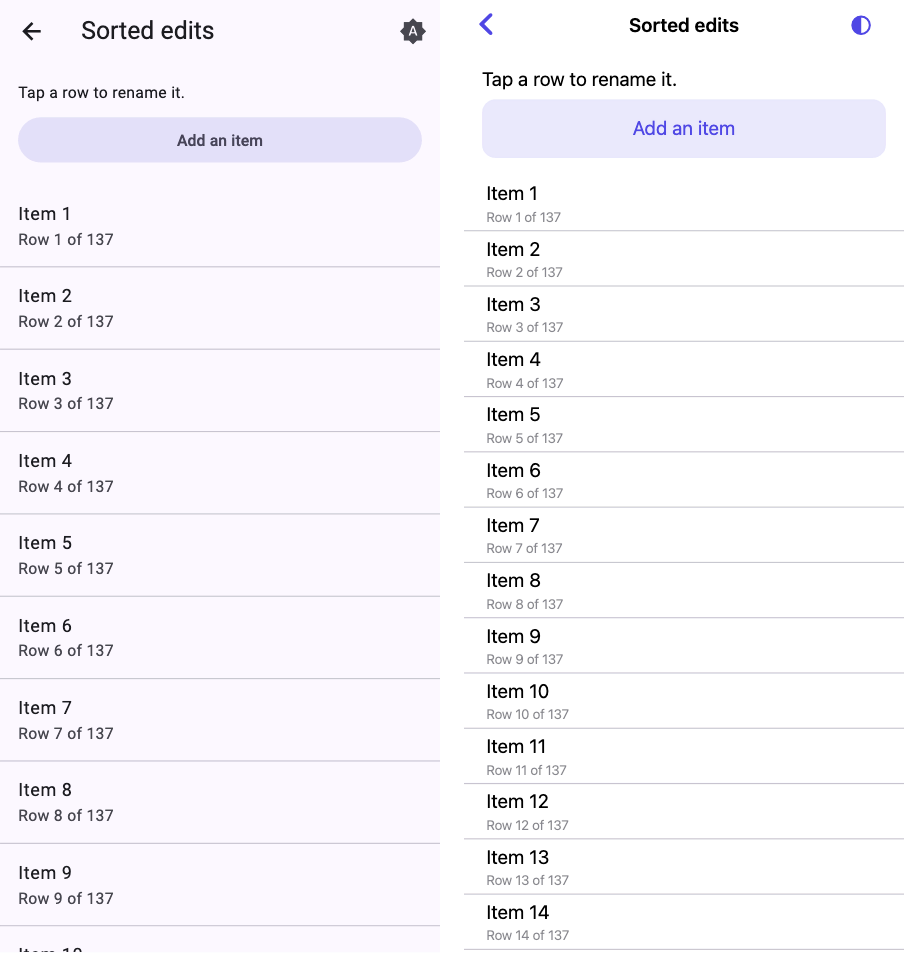
</p>

- Match your server's sort exactly, ties included. In debug, a page out of that order is reported.
- A row sorting after every loaded one waits for its page. Once the data has ended it shows last,
  but never past a `FixedPageCountPolicy` cap.
- Search results keep the order they came in.
- A moved row jumps to its place, keeping its state.

### Before your server answers

`upsertAsync` and `removeAsync` show the edit at once and hold it while your save is out:

```dart
controller.upsertAsync(
  draft,
  commit: api.save(draft),
  onFailure: (_) => showSnackBar("Couldn't save"),
);
```

<p align="center">
  
</p>

- The draft shows over every page until `commit` answers, whatever the list reads meanwhile.
- Then the item `commit` returned shows, and lasts like any edit. It has to keep the draft's id,
  which an assert checks. If your server picks ids, create first, then `upsert` what it returns.
- If `commit` fails, the draft goes, what it covered comes back, and `onFailure` gets the exception.
  Nothing throws, so a call you don't await is safe. An `Error`, a bug in your save, is undone too,
  then goes on to your app.
- `reset()` drops every draft, and a save answering after it changes nothing.

`removeAsync` fits `Dismissible.onDismissed` as it is:

```dart
itemBuilder: (context, task, index) => Dismissible(
  key: ValueKey(task.id),
  onDismissed: (_) => controller.removeAsync(
    task,
    commit: api.delete(task),
    onFailure: (_) => showSnackBar("Couldn't delete"),
  ),
  child: TaskTile(task),
),
```

If your app caches, keep a draft out of the cache until its save answers, or a re-read can keep a
failed draft on screen. And time your calls out: a save that never answers keeps its draft until
`reset()`.

### Animating edits

Pass an `editTransition`, and the row an `upsert` adds animates in and the row a `remove` takes
animates out:

```dart
ListSmith.async(
  fetchPage: PageFetcher(...),
  itemIdGetter: (task) => task.id,
  itemBuilder: ...,
  controller: controller,
  editTransition: EditTransition(
    duration: const Duration(milliseconds: 300),
    transitionBuilder: (child, animation) => SizeTransition(sizeFactor: animation, child: child),
  ),
)
```

The `transitionBuilder` runs forward for a row coming in and backwards for one going out, so any
transition works, `AnimatedSwitcher.defaultTransitionBuilder` included. list_smith brings the
timing, never a look.

- Only edits animate. Page loads, reloads and rows scrolling in show at once.
- A removed row stays until its exit ends, so upserting it meanwhile brings it back.
- Rollbacks animate too: a failed create leaves like a `remove`, a failed delete comes back like an
  `upsert`.
- A row that shrinks itself, like a `Dismissible` or a Slidable's full swipe, goes at once.
- With the platform's reduce-motion setting on, edits show at once.

### On a `.sync` list

`.sync` has no controller. Pass a new list to change it, since it only reads `items` again when it
gets a new object:

```dart
setState(() => _contacts = [..._contacts, added]);  // not _contacts.add(added)
```

Editing the list you passed shows nothing, and asserts in debug.

With an `itemIdGetter`, rows follow their item here too, and the row being read holds still. Always
pass one, since a later release requires it. Without one, rows follow their position and nothing
holds still. Each item needs its own id, and a repeat shows only its 1st item, reported in debug.

## Search

### In memory, with `ListSmith.sync`

Give `.sync` the items and a predicate that decides whether an item matches the query. It filters
client-side, and shows a "no results" surface when nothing does. The common case, any text field
containing the query, has a builder:

```dart
ListSmith<City>.sync(
  items: allCities,
  itemIdGetter: (city) => city.id,
  searchBy: SyncSearchPredicates.fields([(city) => city.name, (city) => city.country]),
  query: searchQuery, // you own the field, more on that below
  itemBuilder: (context, city, index) => Text(city.name),
)
```

Case-insensitive, over every field you list, skipping `null` ones, so a nullable field needs no
`?? ''`. Type the list once (`ListSmith<City>.sync`) and every builder's item type resolves.

Same idea, other matches: `prefix` for type-ahead, `exact`, and `allTerms`, where every word must
hit some field, so `"john smith"` finds `"Smith, John"`. Combine any of them, or your own, with
`SyncSearchPredicates.any` (OR) and `.every` (AND).

Case-sensitive or diacritic-folded? The predicate is yours, a plain `bool Function(item, query)`:

```dart
searchBy: (city, query) => city.name.toLowerCase().contains(query.toLowerCase()),
```

Or swap in [fuzzywuzzy](https://pub.dev/packages/fuzzywuzzy) so near-misses still hit:

```dart
searchBy: (city, query) => weightedRatio(city.name, query) >= 70, // 0-100, tune the cutoff
```

No search needed at all? A plain `ListView.builder` will do.

### Paged, with `ListSmith.async`

Pass `search: AsyncSearch(...)` and the list grows a 2nd mode: an empty query shows the feed, any
other shows paged *search results*, and clearing it goes back. Pagination and pull-to-refresh work
in both:

```dart
ListSmith.async(
  fetchPage: PageFetcher((request) => repo.feed(request.pageIndex, request.pageSize)),
  itemIdGetter: (item) => item.id,
  search: AsyncSearch(
    fetchPage: SearchPageFetcher((r) => repo.search(r.query, r.pageIndex, r.pageSize)),
  ),
  query: searchQuery,
  itemBuilder: (context, item, index) => Text(item.title),
)
```

<details>
<summary><b>What happens to the feed while you search?</b></summary>

| Policy                           | Reach for it when                                                                            |
|----------------------------------|----------------------------------------------------------------------------------------------|
| `ReplaceCachePolicy` *(default)* | a clean reload each way is fine, or the feed should pick up changes it was never told about. |
| `KeepCachePolicy`                | returning to the feed should be instant: its pages and scroll position are kept, no refetch. |

```dart
search: AsyncSearch(fetchPage: mySearchFetcher, cachePolicy: const KeepCachePolicy()),
```

Except:

- a page still loading when the search started is asked again
- a pull, `refresh()` or `invalidate()` while searching re-reads the kept feed in place once you're
  back, reporting that trigger
- `reset()` while searching drops the kept feed, so it comes back from page 0

Dropping `search` mid-search lands like clearing the query. For a fresh feed instead, call
`reset()` right after.

</details>

### You keep the search field

list_smith renders no text field. Keep your own, hold the query in state, and pass it as `query`:

```dart
// inside a StatefulWidget's State:
var _query = '';

@override
Widget build(BuildContext context) => Column(
  children: [
    // your field: a TextField, a CupertinoTextField, your design system's search bar, wherever
    TextField(onChanged: (value) => setState(() => _query = value)),
    Expanded(child: ListSmith.async(query: _query, /* fetchPage, itemIdGetter, search, itemBuilder as above */)),
  ],
);
```

A `ValueNotifier` with a `ValueListenableBuilder` works too, and the field can sit anywhere.
Clearing is `_query = ''`, and the list goes back to the feed on its own.

**`searchDebounce`** waits for typing to settle, with no wait on `.sync`, where filtering is
instant. **`minSearchLength`** ignores anything shorter. The query is trimmed first, so a field of
spaces counts as empty.

### Searching from code

A barcode scan, a deep link, a "more like this" button. `search()` on the
[controller](#refreshing-from-code) searches a query as if it were typed, and `endSearch()` goes
back to what the field holds:

```dart
final byBarcode = SearchPageFetcher((r) => api.productsByBarcode(r.query, r.pageIndex));

await controller.search(code, fetchPage: byBarcode, searchDebounce: Duration.zero);
await controller.endSearch();
```

- **The route comes with the call.** The fetcher you pass serves every page of that search, reloads
  included. Without one, the search's own does.
- **The list's `searchDebounce` and `minSearchLength` apply,** unless the call passes its own.
- **A repeat runs again,** so scanning a code whose lookup failed retries it.
- **Typing takes over.** A field showing the call's query changes nothing, and other text goes
  through the search's own fetcher.

`search()` needs an `AsyncSearch`, as typing does.

## Grouping

Labelled sections instead of one flat run. Pass a `Grouping.by`, with a `groupBy` returning each
item's section key and a `headerBuilder` for its header. Works on both constructors:

```dart
ListSmith.sync(
  items: contacts,
  itemIdGetter: (contact) => contact.id,
  searchBy: (contact, query) => contact.name.toLowerCase().contains(query.toLowerCase()),
  query: searchQuery,
  grouping: Grouping.by(
    groupBy: (Contact contact) => contact.team,
    headerBuilder: (context, team) => SectionHeader(team),
  ),
  itemBuilder: (context, contact, index) => Text(contact.name),
)
```

Grouping runs over what's *visible*, so sections re-form over the matches as you type.

<details>
<summary><b>How sections form, and what to watch</b></summary>

Each group gathers into one section: groups in the order they first show up, items in order within
a group. So items can arrive any way round, on `.async` even spread over pages. There a later page
can add to a section above the one being read, which holds still while it does, with
`shouldKeepPosition` on.

- **Type the `groupBy` parameter,** or pass a typed function, so the key type doesn't widen to
  `Object`.
- **Hold the `Grouping` in a field** on a large list. One built inline re-forms the sections every
  rebuild, and on `.sync` re-buckets too ([cost](#performance)).

</details>

## Make it look like your app

Every surface list_smith draws (loaders, errors, the empty state, the end footer, the pull
indicator) is a neutral `widgets`-layer default, with nothing from Material or Cupertino to fight
your app. Override any slot with your own.

**`emptyBuilder`** (no items) and **`noResultsBuilder`** (a search matched nothing, and it gets the
query) sit on the constructor, since every list has them. The async-only ones gather in an
`AsyncListSurfaces` you can define once and reuse:

```dart
ListSmith.async(
  fetchPage: PageFetcher(...),
  itemIdGetter: (item) => item.id,
  itemBuilder: ...,
  emptyBuilder: (context) => const Center(child: Text('Nothing here yet')),
  surfaces: AsyncListSurfaces(
    firstPageLoadingBuilder: (context) => const MySpinner(),
    firstPageErrorBuilder: (context, error, onRetry) => MyError(error, onRetry: onRetry),
    noMoreItemsBuilder: (context) => const Text("That's everything"),
  ),
)
```

<p align="center">
  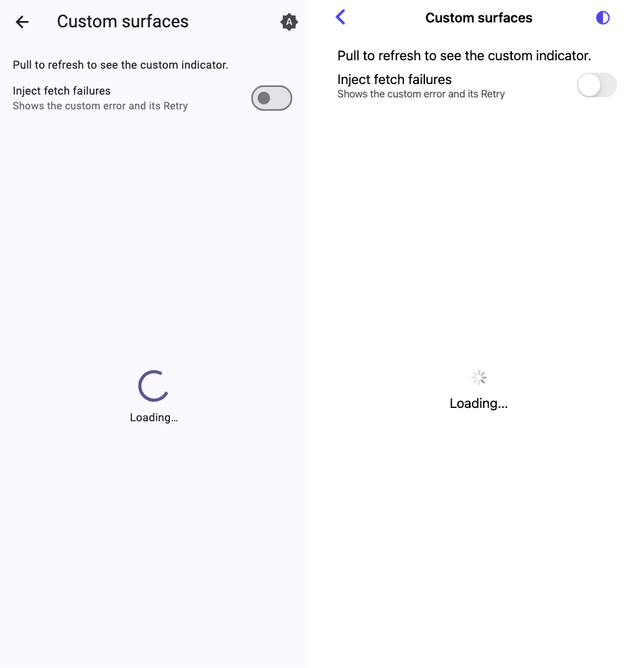
</p>

Its slots: loading and error for the 1st page and for later ones, and `noMoreItemsBuilder` once
every page has loaded. The error builders get `(context, error, onRetry)`, so your error view can
offer a retry. Only an `Exception` from your fetcher gets there: an `Error` is a bug, so it goes on
to your app's error handler. A slot you leave out keeps its neutral default, and the pull indicator
lives on `PullToRefresh`.

Surfaces get exactly the list's visible space, so make yours fit, or wrap it in a
`SingleChildScrollView`.

### Show your own rows while it loads

Nicer than a spinner: hand the loading slots the row you already build, with a stand-in item.

```dart
ListSmith.async(
  fetchPage: PageFetcher(...),
  itemIdGetter: (article) => article.id,
  itemBuilder: (context, article, index) => ArticleTile(article),
  surfaces: AsyncListSurfaces(
    // Hold the placeholder in a field, or you rebuild it every frame.
    newPageLoadingBuilder: (_) => MyShimmer(child: ArticleTile(_placeholderArticle)),
    // Sparse source? AdvanceToFirstNonEmpty sits on this slot for the whole scan.
    firstPageLoadingBuilder: (_) => MyShimmer(
      child: Column(children: List.filled(3, ArticleTile(_placeholderArticle))),
    ),
  ),
)
```

The shimmer is yours, since list_smith ships none. A row that needs something from the enclosing
scope can hoist its builder to a local that both slots call.

## Watching what it does

Log a load, report an error, count searches. Pass an `observer`, and every callback hands you plain
values (a page index, a count, the query, the error), never a controller or a paging type:

```dart
final class MyObserver extends ListSmithObserver {
  const MyObserver();

  @override
  void onError(Exception exception, StackTrace stackTrace) => crashReporter.record(exception, stackTrace);
}

ListSmith.async(
  fetchPage: PageFetcher(...),
  itemIdGetter: (item) => item.id,
  itemBuilder: ...,
  observer: const MyObserver(),
)
```

Override only what you need, and the rest cost nothing: `onPageLoaded`, `onError`, `onReload`,
`onQueryCommitted`, `onSearchModeChanged`. `onReload` carries the trigger its pages will report,
before the 1st is asked for. In a hurry? `LoggingListSmithObserver()` sends every event to
`dart:developer`, so it shows in DevTools and stays `avoid_print`-clean. Callbacks run
synchronously while a page loads, so keep them light ([cost](#performance)).

Observers are async-only, since a `.sync` list has no fetch or refresh to watch, and you already
hold its query.

## Scroll and layout

Padding, physics, a scroll controller, reverse, direction and cache extent live together in a
`ListScrollConfig`, clear of the behaviour parameters:

```dart
scroll: const ListScrollConfig(
  padding: EdgeInsets.all(16),
  physics: BouncingScrollPhysics(),
),
```

## Races and late answers

The user types while an old query's page is loading, or pulls while a page is in the air.
list_smith settles those, each guarantee with a test behind it.

<details>
<summary><b>The guarantees</b></summary>

**A query change drops the pages in flight,** and their cursors, so hits for a query you deleted
never turn up under the one you asked for.

**Group headers come from the whole loaded list,** so a group spanning pages gets one header.

**A refresh drops the pages in flight,** on both reload strategies, so a page asked for before the
pull can't land after it and repeat rows or leave a hole. It's asked again. The same goes when the
feed returns after a search.

**Asking twice doesn't fetch twice.** A refresh asked while one runs joins it, so a double tap
sends 1 request.

**An edit outlives a reload in flight.** A page fetched before your edit shows it when it lands, and
so does the list a failed reload leaves, so a row you just deleted can't come back.

</details>

## Performance

From the committed [benchmark report](benchmark/reports/SUMMARY.md), measured on one phone per
platform for the UI and on macOS for the rest:

- **Scrolling** either constructor costs under a tenth of a millisecond per frame more than a plain
  `ListView.builder`, and drops no frames.
- **A pull-to-refresh and animated edits** stay inside the 60 Hz frame budget.
- **Per-page bookkeeping** (the end policy, observer dispatch) costs under a microsecond.
- **Sync search, sync grouping and de-dup** grow linearly with the list, and pass a frame's budget
  in the tens of thousands of items. Search and grouping run once per committed query, so past that,
  lean on the debounce or go async. De-dup runs once per page arriving, off the scroll path, and
  edits ride the same pass ([`edit_layer_scaling`](benchmark/micro/edit_layer_scaling.dart)).
- **Observer callbacks** run synchronously while a page loads, and a slow one's delay lands on the
  render almost 1:1. Log, count and report there, and do heavy work elsewhere.

Your device will differ, so capture your own baseline before trusting a delta. The suite lives in
[`benchmark/`](benchmark/), and `run.py compare` diffs 2 runs with a Mann-Whitney test.

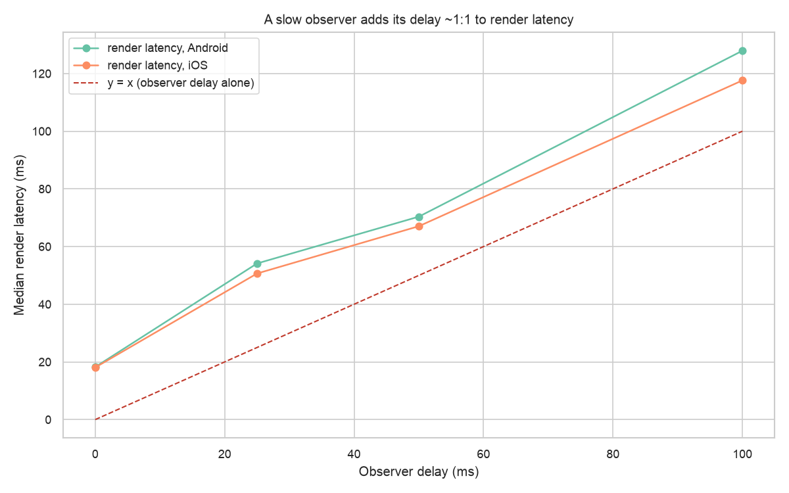

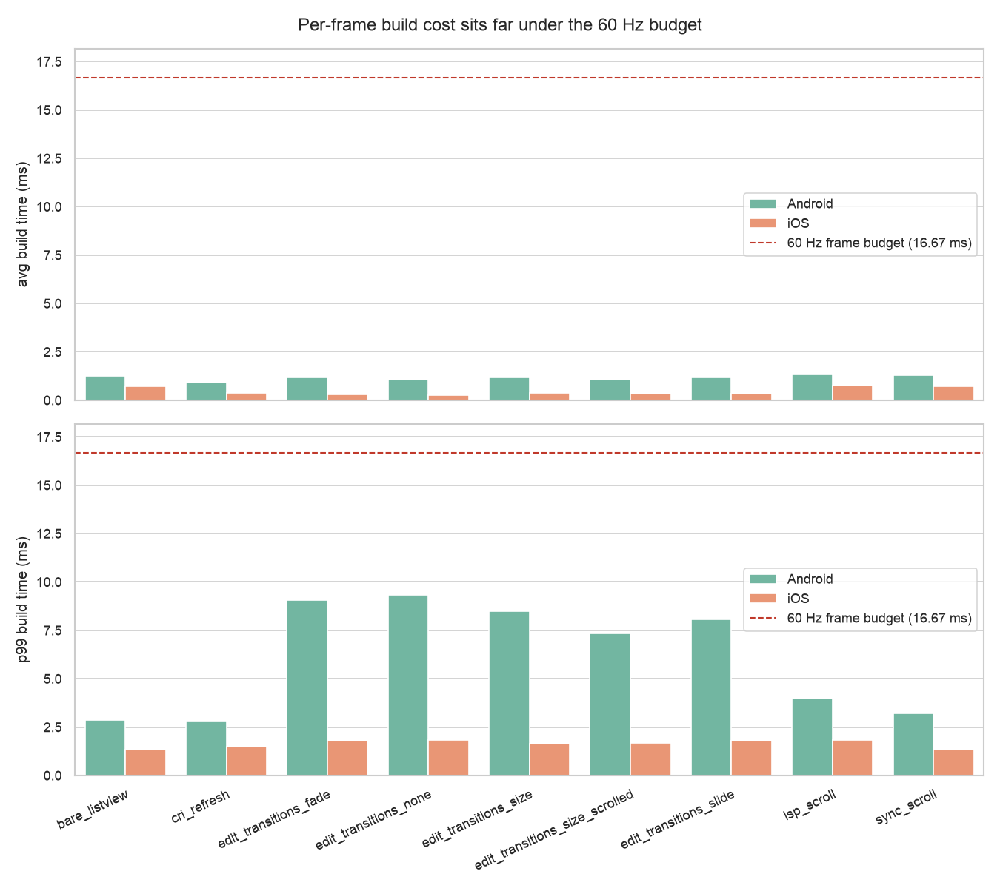

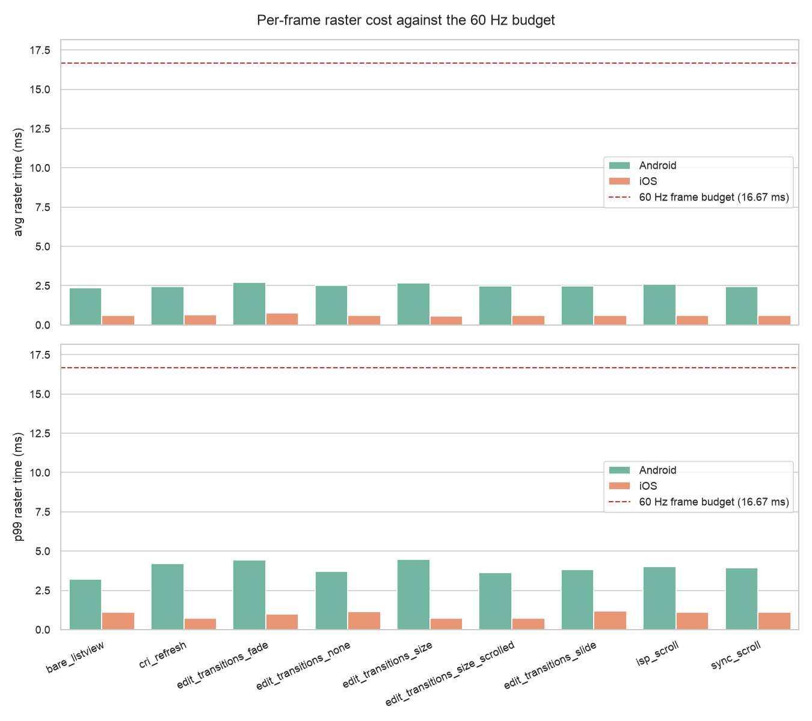

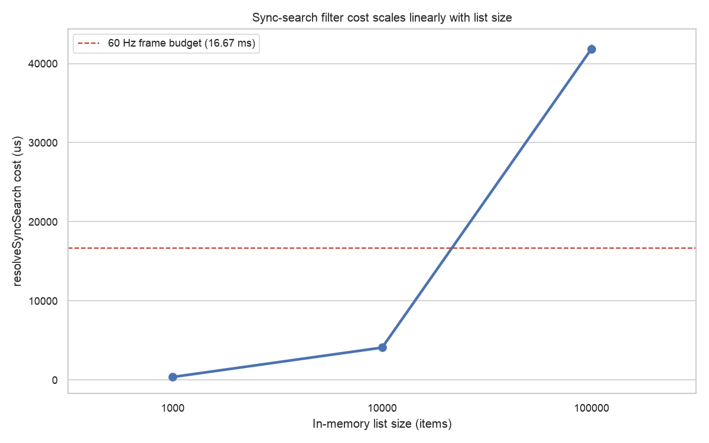

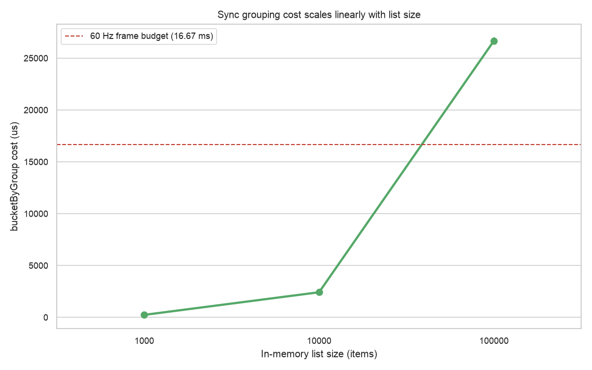

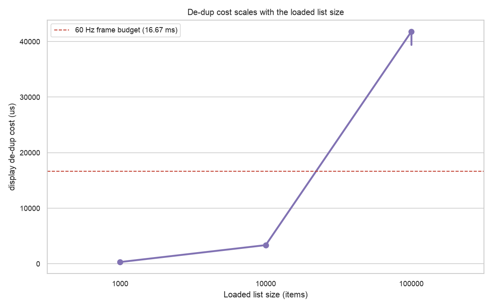

## The example app

The [`example/`](example/) app opens on a list of demos, the best place to watch it all work.

## Contributing

Issues and pull requests are welcome. Read [`AGENTS.md`](.ai/AGENTS.md) for the conventions and
[`CODESTYLE.md`](CODESTYLE.md) for the code style first.
[`doc/how-it-works.md`](doc/how-it-works.md) maps how the parts fit, and
[`APPENDIX.md`](APPENDIX.md) holds the reasoning behind the bigger design decisions.
